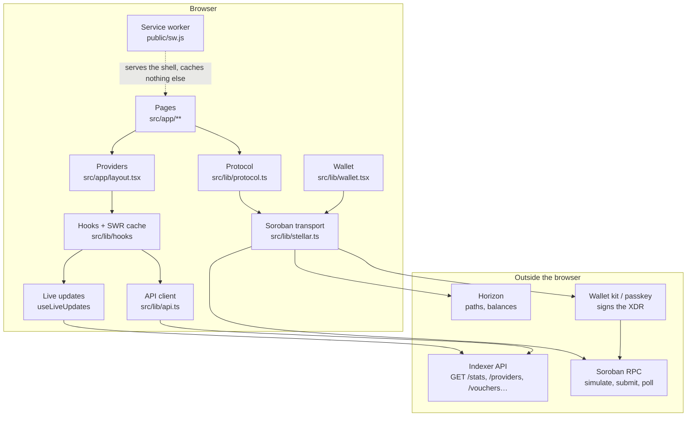
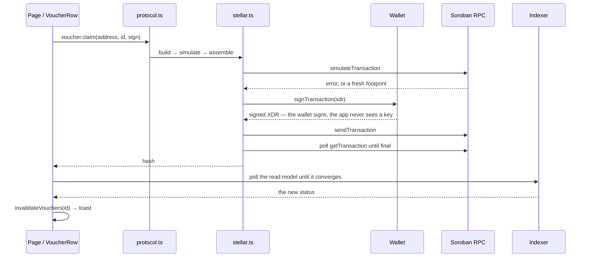

# Frontend architecture

A map of the app for people who have not read it yet: what each layer owns,
which file to open first, and which way the data moves. It is a map, not a
reference — the code stays the source of truth, and every claim here points at
the file that makes it true.

The short version: **the wallet signs and the browser submits to Soroban RPC.**
Reads go to the indexer over HTTP. Optional testnet fee sponsorship sends the
signed envelope to a sign-only sponsor before browser submission; wallet keys
remain in the wallet. See [sponsored fees](sponsored-fees.md) for this exception
and its separate backend dependency.

## Contents

- [The shape of the app](#the-shape-of-the-app)
- [Pages](#pages)
- [Providers](#providers)
- [Hooks and the cache](#hooks-and-the-cache)
- [The API client](#the-api-client)
- [Live updates](#live-updates)
- [The write path: protocol and wallet](#the-write-path-protocol-and-wallet)
- [The offline shell](#the-offline-shell)
- [Where the code lives](#where-the-code-lives)
- [Cross-cutting modules](#cross-cutting-modules)
- [Sharp edges](#sharp-edges)
- [Testing seams](#testing-seams)
- [Configuration](#configuration)
- [Where to change what](#where-to-change-what)

## The shape of the app



Two edges carry everything:

- **Reads** (`pages → hooks → api → indexer`) are HTTP GETs to the indexer.
  The indexer is a separate service ([sci-healthcare-backend](https://github.com/Godgift-care/sci-healthcare-backend))
  that watches the chain and serves a read model.
- **Writes** (`pages → protocol → stellar → wallet → rpc`) never touch the
  indexer. The browser builds the transaction, simulates it, asks the wallet
  to sign it, and submits it to Soroban RPC. The indexer notices the event
  afterwards and the app re-reads to catch up.

Optional sponsored funding inserts `stellar → sponsorship → sponsor` after
wallet signing and before RPC submission. The sponsor returns a signed outer
fee-bump envelope; the browser validates it and submits it. The indexer remains
a read model, and the sponsor service must not submit on the browser's behalf.

## Pages

Every data-bearing page is a **client component** (`'use client'`): the data
lives in SWR and in the browser, and there is no server-side data fetching to
keep in sync. Two routes are static server components (`/how-it-works`,
`/privacy`).

| Route | File | Reads | Notes |
| --- | --- | --- | --- |
| `/` | `src/app/page.tsx` | `useLiveUpdates`, `useProviders`, `useStats`, `useLowBandwidth` | Clinic directory; the map is a `next/dynamic` import with `ssr: false` |
| `/clinics/[address]` | `src/app/clinics/[address]/page.tsx` | `useProvider`, `useVouchers`, `useSavedIdentity` | The funding flow: quote, create, XLM swap |
| `/my` | `src/app/my/page.tsx` | `useLiveUpdates`, `useProviders`, `useReceipts`, `useVouchers` | Funded vouchers, care-history lookup, CSV export |
| `/my/transactions` | `src/app/my/transactions/page.tsx` | `useLiveUpdates`, `useWalletHistory` | The wallet's own transactions, newest first, each linked to the chain |
| `/my/print` | `src/app/my/print/page.tsx` | `useProviders`, `useReceipts`, `useSavedIdentity` | Printable care summary |
| `/clinic` | `src/app/clinic/page.tsx` | `useProvider`, `useVouchers`, `useLiveUpdates` | Clinic-side writes: register, list services, mark seen |
| `/attest` | `src/app/attest/page.tsx` | `useIsAttester`, `useLiveUpdates`, `useVouchers`, `useNow` | Attester queue, sorted by urgency |
| `/attesters` | `src/app/attesters/page.tsx` | `useAttesters({ all })` | Attester directory |
| `/stats` | `src/app/stats/page.tsx` | `useStats`, `useDailyStats`, `useProviders` | Protocol statistics |
| `/vouchers/[id]` | `src/app/vouchers/[id]/page.tsx` | `useVoucher`, `useVoucherEvents`, `useLiveUpdates`, `useNameIndex`, `useNow` | One voucher's timeline, receipt and actions |
| `/faq` | `src/app/faq/page.tsx` | — | Static content; a client component, because the answers are accordions |
| `/how-it-works`, `/privacy` | | — | Static content; server components, and the only two that export their own metadata |

**Metadata lives next door.** A page that is a client component cannot export
`generateMetadata`, so the dynamic titles and link previews are produced by
*sibling server layouts* — `src/app/clinics/[address]/layout.tsx` and
`src/app/vouchers/[id]/layout.tsx` fetch from the API with a short deadline
(`METADATA_TIMEOUT_MS`, 4s in `src/lib/api.ts`) and fall back to the default
title. The sleeping indexer can therefore never block a page render. No
patient or beneficiary reference appears in a title or a preview.

## Providers

`src/app/layout.tsx` mounts them in this order. Anything above a provider can
use it; anything below cannot.

```
<html>
  Analytics          (only when NEXT_PUBLIC_PLAUSIBLE_DOMAIN is set)
  ErrorReporter      (only when NEXT_PUBLIC_SENTRY_DSN is set)
  PendingTransactionGuard
  ServiceWorkerRegistration   (production only)
  WalletProvider
    SwrProvider
      LocaleProvider
        TestnetNotice
        SiteHeader
        main > ToastProvider > {children}
        footer
```

| Provider | Owns |
| --- | --- |
| `Analytics` | Cookieless Plausible pageviews; rendered only when a domain is configured |
| `ErrorReporter` | Sentry init; a no-op without a DSN |
| `PendingTransactionGuard` | The `beforeunload` warning, armed only while a write is in flight |
| `ServiceWorkerRegistration` | Registers `public/sw.js` in production; failures are swallowed |
| `WalletProvider` | The connected account, the sign function, funding checks |
| `SwrProvider` | Application-wide SWR defaults; low-bandwidth mode relaxes them |
| `LocaleProvider` | The active language; `en`, `fr`, `sw` |
| `ToastProvider` | Transaction results and errors; mounted inside `<main>` so a toast appears where the user is looking |

`ToastProvider` sits *inside* `<main>` while `LocaleProvider` wraps both
`<main>` and `<footer>`: the header's controls translate, and toasts do not
paint over the footer.

## Hooks and the cache

`src/lib/hooks/` is the whole read surface — `index.ts` re-exports
`useData`, `useLiveUpdates`, `useNames`, `useNow` and `useWalletHistory`.
Every data hook is a thin SWR wrapper: same key, same fetcher, same shape of
return value. `useWalletHistory` is the exception: the indexer has no
wallet-scoped event log, so it reads the wallet's vouchers and then their
event logs, a few at a time.

| Hook | SWR key | Endpoint |
| --- | --- | --- |
| `useVoucher(id)` | `['voucher', id]` | `GET /vouchers/:id` |
| `useVoucherEvents(id)` | `['voucher-events', id]` | `GET /vouchers/:id/events` |
| `useVouchers(params)` | `['vouchers', params]` | `GET /vouchers` |
| `useWalletHistory(address)` | `['wallet-events', voucherIds]` | `GET /vouchers` + `GET /vouchers/:id/events` |
| `useProvider(address)` | `['provider', address]` | `GET /providers/:address` |
| `useProviders(params)` | `['providers', params ?? {}]` | `GET /providers` |
| `useStats()` | `'stats'` | `GET /stats` |
| `useDailyStats(days)` | `['dailyStats', days]` | `GET /stats/daily` |
| `useAttesters(params)` | `['attesters', params ?? {}]` | `GET /attesters` |
| `useReceipts(beneficiaryRef)` | `['receipts', beneficiaryRef]` | `GET /receipts` |
| `useIsAttester(address)` | `['isAttester', address]` | on-chain read (`registry.isAttester`) |
| `useNameIndex()` | derived from `useProviders` and `useAttesters` | address → name for the loaded directories |
| `useNow()` | — | a shared 60-second clock, for countdowns |

Each hook returns `{ data, error, rawError, isLoading, isValidating, mutate }`.
Two helpers keep the cache honest after a write:

- `invalidateVouchers(voucherId?)` — the voucher, its event log, and every
  `vouchers` / `receipts` / `voucher` / `voucher-events` / `wallet-events`
  key.
- `invalidateProvider(providerAddress?)` — the provider and every `providers` /
  `provider` key.

Global SWR defaults live in `src/components/SwrProvider.tsx`:

| | normal | low-bandwidth |
| --- | --- | --- |
| `revalidateOnFocus` | `true` | `false` |
| `revalidateOnReconnect` | `true` | `false` |
| `dedupingInterval` | 2s | 60s |

Both objects are module-level constants so the context value keeps a stable
identity between renders.

## The API client

`src/lib/api.ts` is the only place the app talks to the indexer.

- The HTTP client and the models come from `@sci-healthcare/client`, generated
  from the backend's OpenAPI contract and vendored in
  `vendor/sci-healthcare-client/`. A route or field change in the indexer
  reaches this app as a **type error**, not a runtime 404.
- `ApiError` carries the status, the backend's error code and a message. A
  network failure becomes `ApiError(0, 'network_error', …)`.
- The base URL is `config.apiUrl` (`NEXT_PUBLIC_API_URL`), with
  `http://localhost:8080` as the development fallback.
- `api` is the surface the app uses: `stats`, `dailyStats`, `providers`,
  `provider`, `vouchers`, `voucher`, `voucherEvents`, `receipts`, `attesters`,
  `attester`.

Two read paths deliberately bypass the generated client, because the OpenAPI
schema has not caught up with the backend yet. Both are marked in the code and
both should be deleted when it does:

- `api.voucherEvents` uses `rawGet('/vouchers/:id/events')`.
- `api.attesters` uses `rawGet('/attesters')` with the documented envelope.

The voucher model is extended the same way: `Voucher` is the generated type
plus `disputeOutcome` and `disputeResolvedAt` (backend #47).

## Live updates

`useLiveUpdates` (`src/lib/hooks/useLiveUpdates.ts`) keeps a page fresh:

- It opens an **SSE** connection to `GET {apiUrl}/events`, optionally scoped
  with `?voucherId=` or `?provider=`. It listens to `message` and to the
  explicit `update`, `voucher` and `provider` event names.
- When an event lands, the relevant SWR keys are invalidated: a voucher event
  refreshes `['voucher', id]`, `['voucher-events', id]` and every `vouchers`
  key; a provider event refreshes `['provider', addr]` and every `providers`
  key; an event with no scope invalidates the whole cache.
- If the stream errors, or `EventSource` is missing, the hook **falls back to
  polling** (6s by default) and keeps working.
- In low-bandwidth mode the stream is never opened; the hook polls every 60s
  instead (`LOW_BANDWIDTH_POLL_INTERVAL_MS`).

`tests/e2e` drives the interval through `window.__SCI_POLL_INTERVAL_MS__`.

## The write path: protocol and wallet

Four files, one direction of travel.



**`src/lib/protocol.ts`** — typed wrappers over the contracts. Each call
builds a client from the runtime config (`contractId`, `networkPassphrase`,
`rpcUrl`), and encodes arguments with the contract's own spec
(`spec.funcArgsToScVals`), so argument names and order come from the contract
rather than from a hand-maintained list. The wrappers cover voucher creation
(single, batched and with an XLM swap), claim, attest, dispute, settle and
refund, plus the registry (register a provider, upsert or remove a service),
the faucet and the USDC balance.

**`src/lib/stellar.ts`** — the transport. The SDK is imported lazily
(`await import('@stellar/stellar-sdk')`), so a read-only page never downloads
it. `invokeContract` builds the transaction, **simulates it**, assembles it
with the simulated footprint, asks the wallet to sign, submits it to RPC and
polls `getTransaction` every 1.5s until it is final (45s ceiling). Simulation
comes first on purpose: a transaction already known to fail must never reach
a wallet prompt. `readContract` does the same call without a signature, from
an unfunded account, so contract reads cost nothing.

**`src/lib/sponsorship.ts`** — the opt-in testnet fee-bump client. Only a single
`create_voucher` call may request it, within amount and fee caps. It checks the
exact inner signed envelope and the sponsor signature before returning the
fee bump to `stellar.ts`. Refusals never automatically fall back to user-paid
fees. The backend independently enforces first-voucher eligibility and quotas.

**`src/lib/wallet.tsx`** — the wallet. The app never holds, requests or
transmits a secret key: the wallet kit signs, and the browser submits to RPC.
The provider owns the connected address, the wallet name, the funding checks
(`isUnfunded`, `isLowXlm`, `spendableXlm`) and `signTransaction`. The kit is
lazily imported and initialised exactly once. A session is restored from
`sci-wallet-connected` / `sci-wallet-id` in `localStorage`.

**`src/lib/passkey.ts`** — a WebAuthn-based smart wallet. The contract
address is derived as `StrKey.encodeContract(SHA-256(rawId))`, and the
credential is stored under `sci:passkey:*`.

After a write, the app does not trust its own optimism: `src/lib/reconcile.ts`
polls the indexer with exponential backoff until the voucher shows the status
the transaction should have produced, then invalidates the cache and toasts
the result.

## The offline shell

`public/sw.js` is deliberately narrow, and the reason is on the file itself:
a clinic phone is often shared, so anything cached is something the next
person can read.

- It caches the **shell** only: `/`, the manifest, the icons and the
  content-hashed `/_next/static/*` output. That is enough to paint the app
  frame with no network at all.
- It caches **no API answer**. Cross-origin requests (indexer, Soroban RPC,
  Horizon, map tiles, analytics) are passed straight through, and Next's
  same-origin RSC payloads (`?_rsc=`) are passed through too, because they
  carry page content.
- Navigations are **network-first** with the cached `/` as the offline
  fallback; shell assets are **cache-first**; a request is never served from
  cache while the network answers.
- Writes are untouched — they were never cacheable.

A cached API answer would also be *wrong*, not just leaky: a voucher's state
comes from the chain, so yesterday's response invites a funder to act on a
state that no longer holds.

## Where the code lives

```
src/app/            Routes: pages, layouts, loading and error boundaries
src/components/     UI and feature components (the design system is ui.tsx)
src/lib/            Domain logic: api, protocol, wallet, hooks, contracts
src/lib/contracts/generated/   Soroban TS bindings (registry, voucher, faucet)
src/lib/hooks/      The whole read surface
src/i18n/           Locale context and the locale configuration
src/messages/       en.json, fr.json, sw.json
src/lib/*.test.ts   Vitest unit tests
tests/e2e/          Playwright specs, fixtures and the mock backend
tests/visual/       Playwright snapshots (6 routes × 2 viewports)
public/sw.js        The offline shell
vendor/sci-healthcare-client/  The generated OpenAPI client
```

## Cross-cutting modules

| Module | Owns |
| --- | --- |
| `src/lib/config.ts` | Build-time configuration, `isTestnet`, explorer links |
| `src/lib/amounts.ts` | i128 amounts (7 decimals), currency, date and address formatting |
| `src/lib/beneficiary.ts` | The local HMAC that derives `beneficiaryRef`; the saved-patients store |
| `src/lib/voucher-actions.ts` | Which actions a voucher currently allows (`availableActions`) |
| `src/lib/timeline.ts` | The voucher timeline and its per-step transaction hashes |
| `src/lib/disputes.ts` | Dispute reason codes and their labels |
| `src/lib/errors.ts` | Contract error codes → plain language, per locale |
| `src/lib/reconcile.ts` | Polling the indexer until it agrees with a write |
| `src/lib/pending-tx.ts` | The in-flight write count that arms the unload guard |
| `src/lib/low-bandwidth.ts` | The "low data" switch and its store |
| `src/lib/theme.ts` | The theme store and the pre-paint init script |
| `src/lib/tour.ts` | The demo-tour flag |
| `src/lib/csv.ts` | CSV row building and download |
| `src/lib/names.ts` | Address → name for the loaded directories |
| `src/lib/analytics.ts` | The event allow-list and route normalisation |
| `src/lib/error-reporting.ts` | The Sentry scrubber |
| `src/lib/e2e-seam.ts` | The mock wallet and mock RPC the e2e suites install |
| `src/i18n/LocaleContext.tsx` | The locale store, `t()` and the formatters |
| `docs/i18n.md` | How to add a language |

## Sharp edges

Behaviours that surprise people reading the code for the first time. Each one
is deliberate or already known; none of them is a secret.

- **The pending-transaction guard covers one of three write paths.**
  `invokeContract` arms it (`src/lib/stellar.ts`); the XLM-swap path
  (`invokePathPaymentThenContract`) and the batch path (`invokeContractBatch`)
  call the internal `invoke` directly and never arm it, so a navigation
  during those two writes is not warned about.
- **Passkey signing is not finished.** `signWithPasskey` performs the WebAuthn
  assertion and returns the XDR unchanged — the signature is not attached to
  the auth envelope — and `PasskeyModule.getNetwork()` hardcodes testnet
  rather than reading `config.network`.
- **`NEXT_PUBLIC_RECEIPT_CONTRACT_ID` is required by the build check but
  unused at runtime.** Receipts come from the indexer, not from a contract
  call, and there is no receipt binding in `src/lib/contracts/generated/`.
- **The voucher page computes its own action list**
  (`src/app/vouchers/[id]/page.tsx`) instead of using `availableActions` from
  `src/lib/voucher-actions.ts`, which `VoucherRow` does use. Two places, two
  rules.
- **Two SWR keys reach `/attesters`.** `useNameIndex` asks for
  `useAttesters()` (`['attesters', {}]`) while the directory page asks for
  `useAttesters({ all })` (`['attesters', { all: true }]`), so the two are
  separate requests — and the name index only covers the first page of
  attesters.
- **A 404 from the event log is not an error.** `useVoucherEvents` sets
  `shouldRetryOnError: false` and the page renders the same timeline without
  transaction links, so "the indexer is too old" and "there are no events" look
  the same on screen.
- **The event log does not say who signed a transaction.** It records the
  event, the ledger and the transaction hash; the actor lives in the
  contract's topics, which the indexer does not publish. Settling and
  refunding are permissionless, so their signer is unknowable, and a voucher
  does not carry its attester. The wallet's transaction history therefore
  attributes only what the contract's own rules make certain, and says
  "the signer is not recorded" for the rest (`src/lib/wallet-history.ts`).
- **The generated bindings carry testnet contract ids** in an exported
  `networks` constant. The runtime path overrides them from `config`, so the
  app is correct, but the export is a trap.
- **`useLiveUpdates` with no scope invalidates every SWR key** in the app.

## Testing seams

The app is built to be testable without a chain and without a network.

- **Unit** — Vitest, `environment: 'node'`, `src/**/*.test.ts`. The pure
  helpers: amounts, api, beneficiary, csv, disputes, errors, expiry, names,
  protocol, reconcile, stellar, timeline, voucher-actions, wallet-history,
  plus the QR scanner component.
- **E2E** — Playwright, `tests/e2e/`. `mockBackend(page)` intercepts
  `http://localhost:8080/**` and serves the indexer's read model;
  `useMockWallet(page, address)` installs `window.__SCI_MOCK_WALLET__` and
  `window.__SCI_MOCK_RPC__`, so writes are recorded instead of signed and
  submitted; `mockInvokes(page)` returns what was called. The mock backend
  has a `voucherConverges` state that flips a voucher's status after N reads,
  which is how the reconcile path is exercised. No testnet, no deployed
  contracts.
- **Visual** — `tests/visual/` screenshots six routes at 1280px and 390px
  with a frozen clock and a mocked API. Run `npm run test:visual:update`
  after an intentional UI change and commit the new snapshots.
- **The mock RPC throws for anything it does not know**, so a missing double
  fails loudly instead of returning a plausible wrong value.

## Configuration

`src/lib/config.ts` reads the environment, and `next.config.ts` reads the same
variables to build the Content-Security-Policy — so the allow-list cannot
drift from the origins the app actually calls.

`NEXT_PUBLIC_*` is inlined **at build time**. Setting a variable only in the
host's runtime environment produces a build that still points at localhost;
this is the single most common deployment failure for this shape of app.
`npm run build` therefore refuses to start without the required values and
lists every missing one at once.

Required: `NEXT_PUBLIC_API_URL`, `NEXT_PUBLIC_STELLAR_NETWORK`,
`NEXT_PUBLIC_SOROBAN_RPC_URL`, `NEXT_PUBLIC_NETWORK_PASSPHRASE`,
`NEXT_PUBLIC_REGISTRY_CONTRACT_ID`, `NEXT_PUBLIC_VOUCHER_CONTRACT_ID`,
`NEXT_PUBLIC_RECEIPT_CONTRACT_ID`, `NEXT_PUBLIC_USDC_CONTRACT_ID`.
Optional: `NEXT_PUBLIC_FAUCET_CONTRACT_ID`, `NEXT_PUBLIC_USDC_ISSUER`,
`NEXT_PUBLIC_PLAUSIBLE_DOMAIN`, `NEXT_PUBLIC_SENTRY_DSN`,
`NEXT_PUBLIC_SPONSORED_FEES`, `CSP_ENFORCE`.

`NEXT_PUBLIC_STELLAR_NETWORK` drives everything testnet-specific through one
helper (`isTestnet`): the header badge, the faucet, the notices and the footer
disclaimer. Setting it to `public` hides all of it.

## Where to change what

| You want to… | Start at |
| --- | --- |
| Add a page | `src/app/<route>/page.tsx`, then a sibling `layout.tsx` if it needs its own title |
| Read a new piece of indexer data | `@sci-healthcare/client` → `src/lib/api.ts` → a hook in `src/lib/hooks/useData.ts` |
| Change the cache behaviour | `src/components/SwrProvider.tsx` (global) or the hook's SWR config (per read) |
| Add or change a contract call | `src/lib/contracts/generated/` → `src/lib/protocol.ts` → `src/lib/stellar.ts` |
| Add a transaction | `src/lib/protocol.ts` (wrapper) → `src/components/VoucherRow.tsx` (the action) → `src/lib/reconcile.ts` (the catch-up) |
| Change what a user can do with a voucher | `src/lib/voucher-actions.ts`, and the page's own copy of the rules |
| Change the offline behaviour | `public/sw.js`, and `tests/e2e/offline-shell.spec.ts` |
| Add a language | `docs/i18n.md` |
| Change the wallet | `src/lib/wallet.tsx`, `src/lib/passkey.ts` |
| Change a policy (CSP, headers) | `next.config.ts` |
